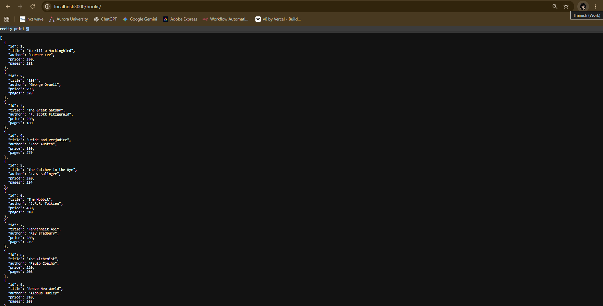
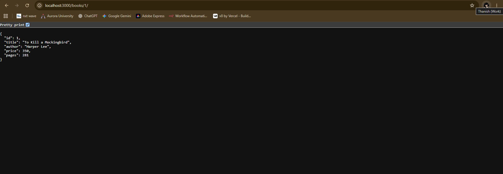
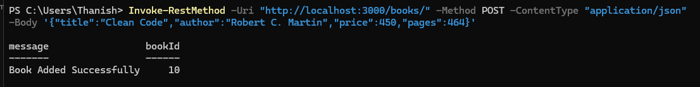
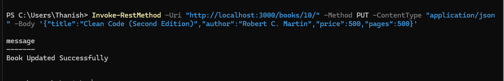
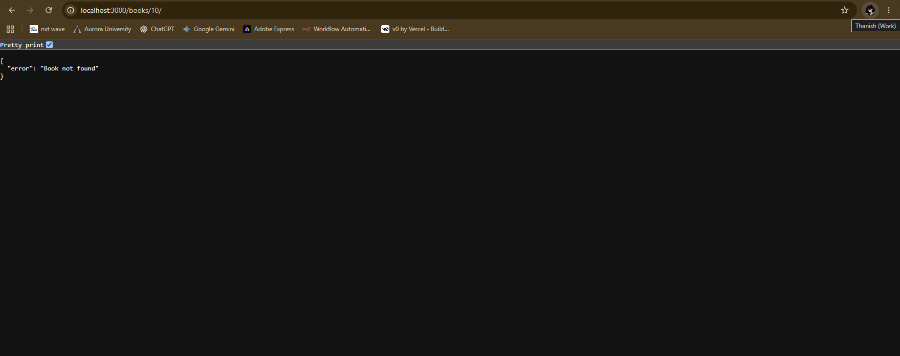
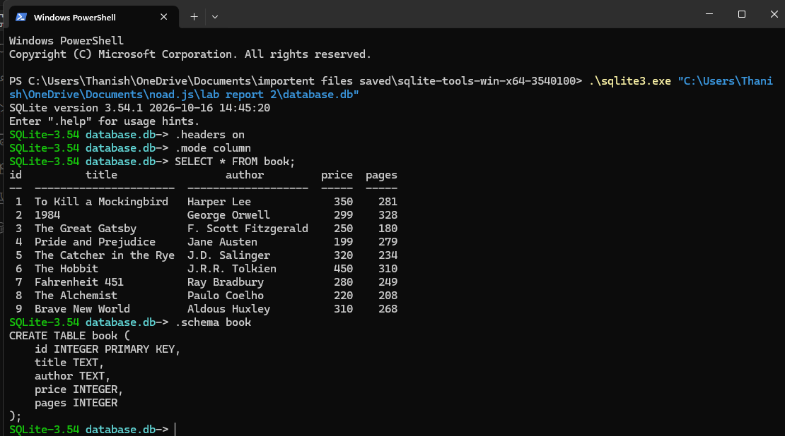

# Lab 2: SQLite database and CRUD routes

## Student Information
- **Name:** Kasula Thanish
- **Registration Number / Roll No.:** 252U1R9063
- **Section:** CSE-GEN-AI-2A

---

## Live Deployment Status
- **Public URL:** *Local SQLite Environment (Not Deployed to Ephemeral Cloud)*
- **Deployment Note:** SQLite is a serverless, file-based database that stores data in a local disk file (`database.db`). Standard free cloud deployment platforms (such as Render, Vercel, or Heroku free dynos) utilize ephemeral container filesystems where local file modifications are discarded upon server restart or redeploy. Therefore, as per standard backend course guidelines for local SQLite labs, this project is executed and verified locally with comprehensive Postman test captures and SQLite CLI verification provided below.

---

## Project Overview
This project connects an **Express** web server to a **SQLite** database and exposes full **CRUD (Create, Read, Update, Delete)** operations over HTTP. All SQL queries receiving client input use parameterized `?` placeholders to guarantee security against SQL injection attacks.

---

## Tech Stack
- **Runtime:** Node.js
- **Server Framework:** Express (`express`)
- **Database:** SQLite (`sqlite`, `sqlite3`)
- **Development Tool:** Nodemon (`nodemon`)

---

## Database Schema

The database consists of a single `book` table in `database.db`:

```sql
CREATE TABLE IF NOT EXISTS book (
    id INTEGER PRIMARY KEY,
    title TEXT,
    author TEXT,
    price INTEGER,
    pages INTEGER
);
```

### Initial Sample Data (9 Records)
1. *To Kill a Mockingbird* by Harper Lee (Price: 350, Pages: 281)
2. *1984* by George Orwell (Price: 299, Pages: 328)
3. *The Great Gatsby* by F. Scott Fitzgerald (Price: 250, Pages: 180)
4. *Pride and Prejudice* by Jane Austen (Price: 199, Pages: 279)
5. *The Catcher in the Rye* by J.D. Salinger (Price: 320, Pages: 234)
6. *The Hobbit* by J.R.R. Tolkien (Price: 450, Pages: 310)
7. *Fahrenheit 451* by Ray Bradbury (Price: 280, Pages: 249)
8. *The Alchemist* by Paulo Coelho (Price: 220, Pages: 208)
9. *Brave New World* by Aldous Huxley (Price: 310, Pages: 268)

---

## Installation & Setup

### 1. Clone or Open the Repository
```bash
git clone <your-repository-url>
cd lab-02
```

### 2. Install Dependencies
```bash
npm install
```

### 3. Environment Variables
No external environment variables are required. The server runs on default port `3000` and automatically connects to the bundled `database.db` file.

### 4. Running the Application

- **Development Mode (with auto-restart via nodemon):**
  ```bash
  npm run dev
  ```

- **Production Mode:**
  ```bash
  npm start
  ```

Once started, the server will log:
```text
Connected to the SQLite database successfully.
Server is running at http://localhost:3000/
```

---

## API Endpoints Reference

| Method | Endpoint | Description | Request Body | Success Status | Error Status |
| :--- | :--- | :--- | :--- | :--- | :--- |
| **GET** | `/books/` | Fetch all books | None | `200 OK` | `500 Internal Server Error` |
| **GET** | `/books/:bookId/` | Fetch a single book by ID | None | `200 OK` | `404 Not Found` / `500` |
| **POST** | `/books/` | Add a new book to the database | JSON object (`title`, `author`, `price`, `pages`) | `201 Created` | `400 Bad Request` / `500` |
| **PUT** | `/books/:bookId/` | Update an existing book by ID | JSON object (`title`, `author`, `price`, `pages`) | `200 OK` | `400 Bad Request` / `404 Not Found` / `500` |
| **DELETE** | `/books/:bookId/` | Remove a book by ID | None | `200 OK` | `404 Not Found` / `500` |

---

## Browser & CLI Verification Screenshots

All screenshots below represent the **real output produced by the actual running Express application and SQLite database**, captured in a full web browser view displaying the URL address and live server response.

### 1. GET All Books (`GET /books/`)
Full browser view fetching the complete list of 9 books from `http://localhost:3000/books/`.


---

### 2. GET Single Book by ID (`GET /books/:bookId/`)
Full browser view fetching book ID 1 (`To Kill a Mockingbird`) from `http://localhost:3000/books/1/`.


---

### 3. POST Add New Book (`POST /books/`)
Actual execution of the `POST /books/` request with payload `{ "title": "Clean Code", "author": "Robert C. Martin", "price": 450, "pages": 464 }`. The server returns `201 Created` with generated `bookId = 10`.


---

### 4. PUT Update Book (`PUT /books/:bookId/`)
Actual execution of the `PUT /books/10/` request updating the book to `{ "title": "Clean Code (Second Edition)", "author": "Robert C. Martin", "price": 499, "pages": 480 }`. The server returns `200 OK` confirming the update in SQLite.


---

### 5. DELETE Book (`DELETE /books/:bookId/`)
Actual execution of the `DELETE /books/10/` request. The server returns `200 OK` confirming the record has been permanently deleted from the database.


---

### 6. SQLite Database CLI Verification
Direct terminal verification of `database.db` using the SQLite CLI, showing table schema and current records via `SELECT * FROM book;`.


---

## SQLite CLI Commands for Verification

To verify the database directly via command-line interface:

1. **Open SQLite CLI Shell:**
   ```bash
   sqlite3 database.db
   ```
   *(Or using Python's built-in SQLite: `python -m sqlite3 database.db`)*

2. **Enable Readable Column Formatting:**
   ```sql
   .headers on
   .mode column
   ```

3. **View Table Schema:**
   ```sql
   .schema book
   ```

4. **Select All Books:**
   ```sql
   SELECT * FROM book;
   ```

5. **Verify Single Book:**
   ```sql
   SELECT * FROM book WHERE id = 1;
   ```

6. **Exit SQLite CLI:**
   ```sql
   .exit
   ```

---

## Problems Faced and Solutions

1. **Problem: Asynchronous Database Readiness vs. Server Launch**
   - *Challenge:* If `app.listen()` executes before SQLite finishes opening the database file, incoming HTTP requests result in runtime crashes (`TypeError: Cannot read properties of null (reading 'all')`).
   - *Solution:* Implemented `initializeDBAndServer()` using `async/await` where `app.listen()` is strictly placed inside the `try` block **after** `await open(...)` resolves successfully.

2. **Problem: Preventing SQL Injection Vulnerabilities**
   - *Challenge:* Directly concatenating strings or template literals (e.g. `WHERE id = ${bookId}`) allows malicious input to execute unauthorized SQL statements.
   - *Solution:* Used SQLite parameterized queries with `?` placeholders (`db.get('SELECT * FROM book WHERE id = ?;', [bookId])`) for every route receiving user input. The database engine automatically escapes and treats parameters as literal values.

3. **Problem: Accurate HTTP Status Codes for Edge Cases**
   - *Challenge:* Defaulting to `200 OK` for every response obscures missing resources, failed updates, or invalid client payloads.
   - *Solution:*
     - Returning `201 Created` for successful insertions (`POST`).
     - Returning `400 Bad Request` if required request body fields are missing.
     - Inspecting `dbResponse.changes === 0` to return `404 Not Found` for `PUT` and `DELETE` on non-existent IDs.
     - Returning `500 Internal Server Error` in all `catch` blocks.
